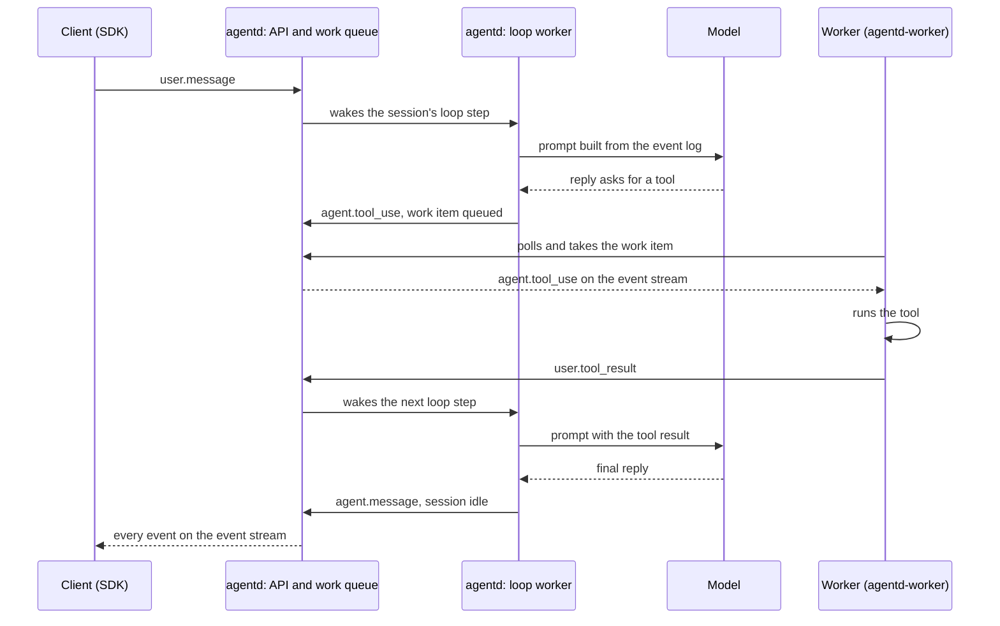

# Runtime parity: the plan in brief

## Summary

agentd serves Anthropic's Managed Agents API and runs the agent loop on the server, as Anthropic does: it calls the
model, records every event, and queues a work item when a tool has to run. A separate container project, `agentd-worker`, runs
Anthropic's own worker, unchanged, which picks up work items and runs the tools. Our `cloud` environments reuse that
container project: we run it ourselves and point it at agentd, exactly as a customer runs it for a `self_hosted`
environment, with each session's sandbox on Cloudflare Containers. At launch agentd is one container on tosspaper's
existing host and Postgres; bigger setups are settings, each switched on when a named alarm says it is needed.

## How a turn flows

## Terms

- **Live**: Anthropic's hosted Managed Agents API, the behaviour agentd copies.
- **Sandbox**: the container a session's tools run in.
- **Harness**: agentd's current Python loop that runs inside each sandbox and writes the agent's events through
  agentd-only `/harness/*` routes; this plan removes it.
- **Outcome grading**: a second model pass that checks the agent's work against a rubric the caller gave.
- **MCP server**: an outside tool server the agent can call; agentd connects to it with the credential stored in
  the session's vaults.
- **Loop worker**: an agentd server whose job is running loop steps; the **step queue** is the list of sessions
  with a step to run.
- **Work token**: the credential a worker gets with a work item; it reaches only that session.
- **Environment key**: the key a worker uses to ask for work; the **runtime queue** is where `cloud` work waits.
- **Loop step**: one pass of a session's loop: read the session's event log, ask the model, record what it said.
  A tool call ends a step; the tool's result starts the next one.
- **Work item**: a queue entry that tells a worker "this session needs you"; its id is the session id.
- **Lease**: a claim with an expiry. A loop worker holds a step's lease while it runs that step; if it dies, the lease
  runs out and another worker takes the step.
- **`EnvironmentWorker`**: Anthropic's worker, part of the official Python SDK. It takes a work item, runs the
  session's tools, and posts each result back.
- **Sidecar**: on the Fargate launcher, a helper container in the same task as the worker, sharing its disk, that
  copies the session's files in and its outputs out. On Cloudflare the session's Durable Object does this job.
- **Placeholder and swap**: a `cloud` sandbox sees a signed placeholder in place of each `environment_variable`
  credential. When a tool in the sandbox (`curl`, `git`) sends it to one of the credential's allowed hosts, the swap,
  outside the sandbox, puts the real value in. On Cloudflare the swap is the session's Durable Object; elsewhere it
  is an optional egress proxy. `self_hosted` sandboxes get no placeholders, as on live.
- **Durable Object**: Cloudflare's per-name server object; each session's container has one, addressed by the
  session id, which starts the container, stages its files and runs the swap.
- **Compaction**: keeping a long conversation inside the model's window. First old tool results are cleared from the
  prompt; later the conversation is summarised into a checkpoint. The event log itself is never cut.
- **`cloud` and `self_hosted`**: the two kinds of environment. A `self_hosted` environment's workers run on the
  customer's machines; a `cloud` environment's workers run on ours. agentd treats both the same way.

## The PRs

agentd (one stack, each PR on your go-ahead; ✔ marks a PR that removes code, ⚙ a PR that only moves code to make
room):

1. The spec (this folder).
2. Work tokens keep working across restarts: their signing key lives in Secrets Manager.
3. Add the `work_items` table.
4. A Postgres store for work items, not used yet.
5. Work items move to Postgres; a work item's id is its session id.
6. The work item's secret carries the same fields as live's.
7. ⚙ Vault credentials get their own files.
8. `cloud` sessions' environment-variable credentials reach the worker as signed placeholders, never values; their
   secrets are tagged so the swap can read only those.
9. Add the `environment_keys` table.
10. Environment keys: create them with a command; poll only with one; live's 401 and 403 answers.
11. A session waiting on a tool result refuses other messages, as live does.
12. Our own runtime key may read the environments of `cloud` sessions, so the Cloudflare launcher can apply their
    networking; customer keys keep live's refusal.
13. Mark events processed in one statement; read the log in order without repeats.
14. Events reach every stream on every replica, through Valkey signals.
15. Streams: a jittered fallback timer, new streams refused while the database is overloaded, the event list read
    from a replica.
16. ⚙ Move the storage settings into their own config file.
17. DynamoDB event log: writes.
18. DynamoDB event log: reads.
19. DynamoDB event log for the workspaces you list.
20. An optional retention period for old sessions' events.
21. Add the `loop_steps` table.
22. Bring the model client back: one retry layer, prompt caching.
23. Bring back the event history and the prompt.
24. Bring back the turn: a tool call waits for a worker.
25. Bring back threads, delegation and interrupts.
26. Bring back outcome grading and the budget.
27. Each model's window, from the provider's models endpoint.
28. The step queue: claim a step, commit it, take over a dead one.
29. Loop workers run steps; the `api` and `loop` roles; a model-call limit per workspace; 256 steps per worker.
30. An account-wide model limit, so all workspaces together stay under the provider's limit.
31. Compaction, first tier: clear old tool results from the prompt.
32. Add the checkpoint index.
33. Compaction, second tier: summarise into a checkpoint, with Anthropic's compaction block.
34. Compaction for other providers, oversized requests and model changes.
35. Work tokens can only answer their own session's open tool calls and read its own files and memory.
36. Workers read the session's mounted files and save its outputs with the work token.
37. Add the `mcp_connections` table.
38. MCP in the loop: connect to the agent's MCP servers, keep their session and tool list, call their tools, record
    Anthropic's MCP events.
39. MCP credentials from the session's vaults, read in each step that uses them, with one OAuth refresh at a time.
40. ⚙ Deployment run errors get their own file.
41. A deployment whose MCP server the environment blocks records the error and pauses, as live does.
42. Vaults as Anthropic documents them: `vault_ids` fixed, archived vaults refused, `token_endpoint` fixed, expiry
    kept, `mcp_oauth_validate`.
43. Sessions run on agentd's loop and queue their work; agentd starts no sandbox (per workspace, behind a setting).
44. Add the `schedules` table.
45. Scheduled deployments fire on any replica, once.
46. Add the webhook deliveries table.
47. Session status webhooks, signed and retried as live does.
48. The official Java SDK runs against agentd in CI, like the Python and TypeScript ones.
49. ✔ Remove the Python harness, the `/harness/*` routes and the harness CI job.
50. ✔ Remove agentd's sandbox launch and the `sandbox-docker` and `sandbox-worker` crates (they move to `agentd-worker`).
51. ✔ Remove the egress proxy crates from agentd (they move to `agentd-worker`).
52. Docs and runbook.

`agentd-worker` (its own repository, `Elmanuel1/agentd-worker`, created on your go-ahead):

1. The worker image: the official `anthropic` SDK only, running `EnvironmentWorker` per work item.
2. Our runtime poller: `ant beta:worker poll --on-work`, handing each work item to the launcher.
3. The Docker launcher, for development and CI.
4. The Cloudflare launcher, for our `cloud`, built on Cloudflare's open-source `@cloudflare/containers` and
   `@cloudflare/sandbox` and on Cloudflare's `claude-managed-agents` template (credited): one container per session
   running the official worker, which alone holds the work item; files staged in and outputs saved through the
   files endpoints; `/workspace` backed up to R2; networking read with our runtime key and enforced by
   `allowedHosts`, failing closed; the environment key never inside the container.
5. The Cloudflare swap: the session's Durable Object attaches `environment_variable` values on allowed hosts, reading
   them from agentd's Secrets Manager with one narrow read key and keeping each for 5 minutes in memory.
6. The optional Fargate launcher with its queue-driven fleet, and the optional EC2 launcher, for AWS-only operators.
7. The optional AWS egress proxy (moved from agentd), for those launchers.

## Your decisions

- The agent loop runs in agentd, server side (2026-11-05, 2026-11-08).
- agentd must match Anthropic feature for feature (2026-11-08).
- No container code in agentd; the container work is a separate project you will also use elsewhere (2026-11-08).
- `cloud` reuses that container project, run by us (2026-11-08); its sandboxes run on Cloudflare Containers, built on
  Cloudflare's own open-source packages (2026-11-08).
- The container project is called `agentd-worker` (2026-11-08).
- Our `cloud` attaches environment-variable credentials at egress, as Anthropic's cloud does; `self_hosted` gets none;
  for anyone else running `agentd-worker` it is optional and off by default (2026-11-08).
- On Cloudflare the session's Durable Object holds the values, read with one narrow AWS key and kept 5 minutes in
  memory; a revoked value can work for up to 5 minutes (2026-11-08).
- agentd hands the worker signed placeholders in the work item's secret, never values, and no new route
  (2026-11-08).
- The Cloudflare launcher reads a `cloud` environment's networking with our runtime key, the only key allowed to;
  if it cannot, the sandbox does not start (2026-11-08).
- One credential store for now, Secrets Manager; envelope encryption when reads pass half of AWS's limit
  (2026-11-08).
- agentd serves MCP servers from the loop with the session's vault credentials (2026-11-08), read once per loop step
  that uses them, with the MCP session and tool list kept per session in Postgres (2026-11-08).
- Vaults behave as Anthropic documents them (2026-11-08).
- Compaction in two tiers: clear old tool results at 100,000 tokens or half the window, summarise at 150,000 tokens
  or 80% of the window (2026-11-08).
- A session's work token may read its own mounted files and save its outputs through the existing files endpoints,
  a departure from live (2026-11-08).
- No session state held in a replica: steps from a Postgres queue, any replica runs the next step (2026-11-08).
- A lean launch: one agentd container on tosspaper's host and Postgres, no RDS Proxy until the connections alarm
  fires (2026-11-08).
- Environment keys in their own table (2026-11-08).
- No endpoint Anthropic does not have (2026-11-06).
- Custom tools are answered by the API caller (2026-11-04).
- Fan-out signals over Valkey; the event log moves to DynamoDB for listed workspaces (2026-11-06).
- Model limits: 32 model calls at once per workspace, 5 attempts, prompt caching (2026-11-08), and an account-wide
  limit (2026-11-08).
- Webhook endpoints configured per organization (2026-11-08).
- The Java SDK joins the conformance suites; tunnels and user profiles get their own plans (2026-11-08).

## What it costs at launch

For 10,000 extractions a month, excluding the model: about $45 to $125. agentd, Postgres, Valkey and S3 ride on
what tosspaper already runs; Cloudflare is the $5 plan plus $23 to $93 of containers and under $5 of Durable
Objects; staging documents from S3 adds about $15 to $20. The full breakdown is in
[requirements.md](requirements.md), section Deployment.

## Appendix

The full detail lives beside this page:

- [requirements.md](requirements.md): every requirement with its ID (W, F, E, S, R, M, L, CP, FO, K, MC, VA, H, EV, J,
  and `agentd-worker`'s EG, CF, FL), the per-PR files, SQL statements and tests, the step queue's statements,
  rollout, deployment and cost, SRE sizing, scale-up triggers and SLOs, the plan's audit.
- [decisions.md](decisions.md): each decision with its source.
- [dependencies.md](dependencies.md): what the design rests on, with evidence.
- [ADR 0001](adr/0001-agent-loop-in-agentd.md): the decision record and the alternatives.

