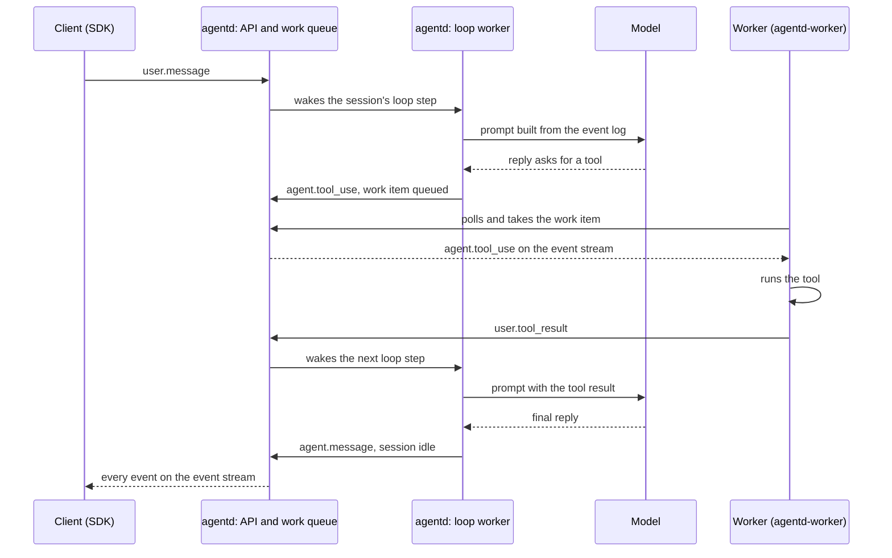

# Runtime parity: the plan in brief

## Summary

agentd serves Anthropic's Managed Agents API and runs the agent loop on the server, as Anthropic does: it calls the
model, records every event, and queues a work item when a tool has to run. A separate container project, `agentd-worker`, runs
Anthropic's own worker, unchanged, which picks up work items and runs the tools. Our `cloud` environments reuse that
container project: we run it ourselves and point it at agentd, exactly as a customer runs it for a `self_hosted`
environment.

## How a turn flows

## Terms

- **Live**: Anthropic's hosted Managed Agents API, the behaviour agentd copies.
- **Sandbox**: the container a session's tools run in.
- **Harness**: agentd's current Python loop that runs inside each sandbox and writes the agent's events through
  agentd-only `/harness/*` routes; this plan removes it.
- **Outcome grading**: a second model pass that checks the agent's work against a rubric the caller gave.
- **MCP server**: an outside tool server the agent can call; agentd connects to it with the credential stored in
  the session's vaults.
- **Loop worker**: an agentd server whose job is running loop steps; the **step queue** is the list of sessions
  with a step to run.
- **Work token**: the credential a worker gets with a work item; it reaches only that session.
- **Environment key**: the key a worker uses to ask for work; the **runtime queue** is where `cloud` work waits.
- **Loop step**: one pass of a session's loop: read the session's event log, ask the model, record what it said.
  A tool call ends a step; the tool's result starts the next one.
- **Work item**: a queue entry that tells a worker "this session needs you"; its id is the session id.
- **Lease**: a claim with an expiry. A loop worker holds a step's lease while it runs that step; if it dies, the lease
  runs out and another worker takes the step.
- **`EnvironmentWorker`**: Anthropic's worker, part of the official Python SDK. It takes a work item, runs the
  session's tools, and posts each result back.
- **Sidecar**: a helper container in the same task as the worker, sharing its disk. Here it copies the session's
  files in and its outputs out.
- **Egress proxy**: the gateway every outbound request from a sandbox goes through. It swaps placeholder credentials
  for real ones, so the sandbox never holds a secret.
- **`cloud` and `self_hosted`**: the two kinds of environment. A `self_hosted` environment's workers run on the
  customer's machines; a `cloud` environment's workers run on ours. agentd treats both the same way.

## The PRs

agentd (one stack, each PR on your go-ahead; ✔ marks a PR that removes code):

1. The spec (this folder).
2. Work tokens keep working across restarts: their signing key lives in Secrets Manager.
3. Add the `work_items` table.
4. A Postgres store for work items, not used yet.
5. Work items move to Postgres; a work item's id is its session id.
6. The work item's secret carries the same fields as live's.
7. Add the `environment_keys` table.
8. Environment keys: create them with a command; poll only with one; live's 401 and 403 answers.
9. A session waiting on a tool result refuses other messages, as live does.
10. Mark events processed in one statement; read the log in order without repeats.
11. Events reach every stream on every replica, through Valkey signals.
12. Move the storage settings into their own config file.
13. DynamoDB event log: writes.
14. DynamoDB event log: reads.
15. DynamoDB event log for the workspaces you list.
16. Add the `loop_steps` table.
17. Bring the model client back: one retry layer, prompt caching.
18. Bring back the event history and the prompt.
19. Bring back the turn: a tool call waits for a worker.
20. Bring back threads, delegation and interrupts.
21. Bring back outcome grading and the budget.
22. The step queue: claim a step, commit it, take over a dead one.
23. Loop workers run steps; the `api` and `loop` roles; a model-call limit per workspace.
24. Work tokens can only answer their own session's open tool calls and read its own files and memory.
25. Workers read the session's mounted files and save its outputs with the work token.
26. MCP in the loop: connect to the agent's MCP servers, call their tools, record Anthropic's MCP events.
27. MCP credentials from the session's vaults, read fresh on every call, with OAuth refresh.
28. Sessions run on agentd's loop and queue their work; agentd starts no sandbox (per workspace, behind a setting).
29. Add the `schedules` table.
30. Scheduled deployments fire on any replica, once.
31. Add the webhook deliveries table.
32. Session status webhooks, signed and retried as live does.
33. ✔ Remove the Python harness, the `/harness/*` routes and the harness CI job.
34. ✔ Remove agentd's sandbox launch and the `sandbox-docker` and `sandbox-worker` crates (they move to `agentd-worker`).
35. ✔ Remove the egress proxy crates from agentd (they move to `agentd-worker`).
36. Docs and runbook.

`agentd-worker` (its own repository, `Elmanuel1/agentd-worker`, created on your go-ahead):

1. The worker image: the official `anthropic` SDK only, running `EnvironmentWorker` per work item.
2. The command `ant beta:worker poll --on-work` runs: start one task per work item.
3. The Docker launcher, for development.
4. The Fargate launcher, for production.
5. The file sidecar: copy the session's files in through the public files endpoints, before the worker starts.
6. The file sidecar: save outputs through the files endpoints, and a `/workspace` snapshot to its own bucket
   (presigned URLs from the launcher, no AWS credentials in the task), when the session finishes a turn and at exit.
7. The egress proxy (moved from agentd): it enforces the environment's networking by default; secret injection
   with placeholders is optional, off by default, with the operator's own secret source.
8. Our `cloud` deployment: workers polling agentd's runtime queue with our key.

## Your decisions

- The agent loop runs in agentd, server side (2026-11-05, 2026-11-08).
- agentd must match Anthropic feature for feature (2026-11-08).
- No container code in agentd; the container work is a separate project you will also use elsewhere (2026-11-08).
- `cloud` reuses that container project, run by us (2026-11-08).
- The container project is called `agentd-worker` (2026-11-08).
- agentd has no part in egress secrets; `agentd-worker`'s operator decides, and our `cloud` deployment injects
  none (2026-11-08).
- agentd serves MCP servers from the loop with the session's vault credentials, read fresh each call (2026-11-08).
- A session's work token may read its own mounted files and save its outputs through the existing files endpoints,
  a departure from live (2026-11-08).
- A `cloud` session's environment-variable credentials are not substituted at egress, a departure from live that
  follows from the egress decision (2026-11-08).
- No session state held in a replica: steps from a Postgres queue, any replica runs the next step (2026-11-08).
- Environment keys in their own table (2026-11-08).
- No endpoint Anthropic does not have (2026-11-06).
- Custom tools are answered by the API caller (2026-11-04).
- Fan-out signals over Valkey; the event log moves to DynamoDB for listed workspaces (2026-11-06).
- Model limits: 32 model calls at once per workspace, 5 attempts, prompt caching (2026-11-08).
- Webhook endpoints configured per organization (2026-11-08).

## Appendix

The full detail lives beside this page:

- [requirements.md](requirements.md): every requirement with its ID (W, F, E, S, R, M, L, FO, K, H), the per-PR
  files, SQL statements and tests, the step queue's statements, rollout, SRE sizing and SLOs, the plan's audit.
- [decisions.md](decisions.md): each decision with its source.
- [dependencies.md](dependencies.md): what the design rests on, with evidence.
- [ADR 0001](adr/0001-agent-loop-in-agentd.md): the decision record and the alternatives.

